<p align="center">
  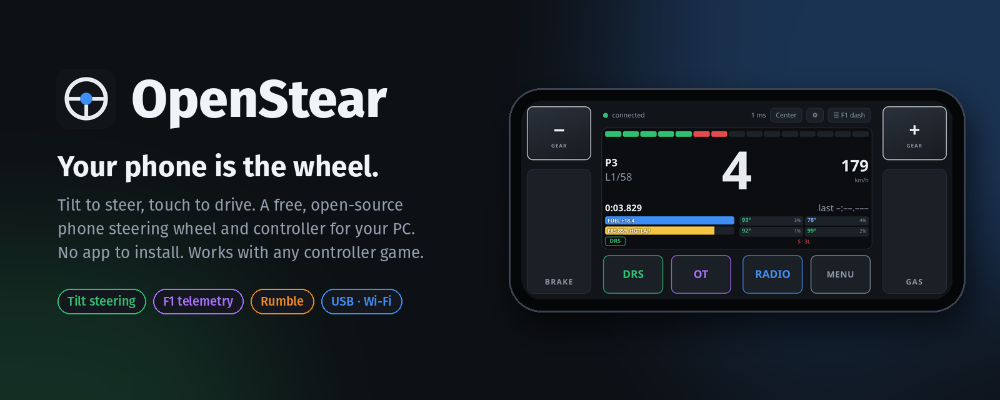
</p>

<p align="center">
  <a href="https://github.com/Het2239/OpenStear/actions/workflows/test.yml"></a>
  <a href="LICENSE"></a>
  
  
  
</p>

<p align="center">
  <a href="#-highlights">Highlights</a> ·
  <a href="#-quick-start">Quick start</a> ·
  <a href="#-layouts">Layouts</a> ·
  <a href="#-f1-telemetry-dash">F1 dash</a> ·
  <a href="#-how-it-works">How it works</a> ·
  <a href="#-troubleshooting">Troubleshooting</a>
</p>

---

**OpenStear** turns the phone in your pocket into a steering wheel, a full
gamepad or a live F1 dashboard for your PC. Open a web page on the phone, tilt
it to steer, and the PC sees a real **Xbox 360 controller**, so every game
with controller support just works. There's no app to install, no account and
no ads, and it's free and open source.

## ✨ Highlights

- 🏎️ **Tilt steering** with calibration, dead zone, response curve and
  smoothing tuned on the phone, plus an on-screen **900° touch wheel** and
  **arcade ◀ / ▶** steering.
- 🎮 **A real virtual controller**: ViGEmBus on Windows, `uinput` on Linux.
  Both sticks, analog triggers, all buttons, up to 4 phones at once.
- 🧩 **Eight built-in layouts**, from classic wheel and F1 wheel to
  Xbox-style and PlayStation-style pads, and a **drag-and-drop editor** to
  build your own.
- ⌨️ **Remap anything**: each button can send an Xbox button, an axis or a
  **keyboard key**, in hold, toggle or pulse mode.
- 🏁 **Live F1 dash** from F1 23 / 24 / 25 telemetry: shift lights, gear,
  lap times, fuel, ERS, DRS and tyres, with a shift-light buzz.
- 📳 **Rumble on your phone**: when the game shakes the controller, your
  phone vibrates (Android).
- 🔌 **USB or Wi-Fi**: USB with ADB, USB tethering or Wi-Fi, with a QR code to
  connect. Pairing keeps other devices out, and wireless connections are
  encrypted (HTTPS).
- 🗂️ **Game profiles**: the PC switches every phone to the right layout when
  a game starts.
- 🛡️ **Fail-safe by design**: if the connection drops, every input is
  released within 300 ms, so the throttle never gets stuck.

## 📸 Screenshots

<table>
  <tr>
    <td width="50%">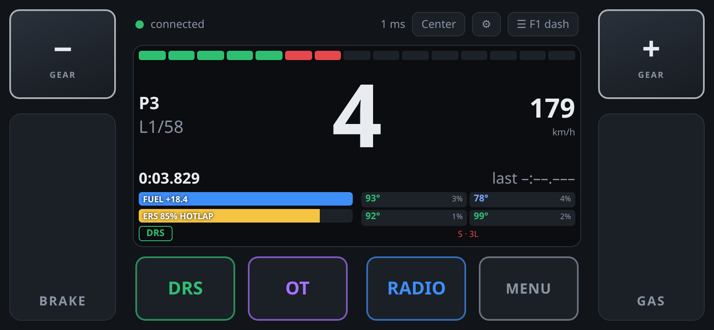<br><sub><b>F1 dash</b>: live telemetry, shift lights, tyres, ERS</sub></td>
    <td width="50%">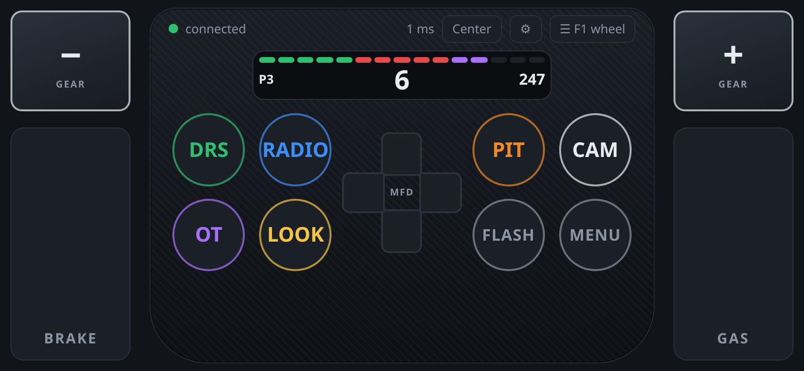<br><sub><b>F1 wheel</b>: paddles, pedals, F1 25 default bindings</sub></td>
  </tr>
  <tr>
    <td>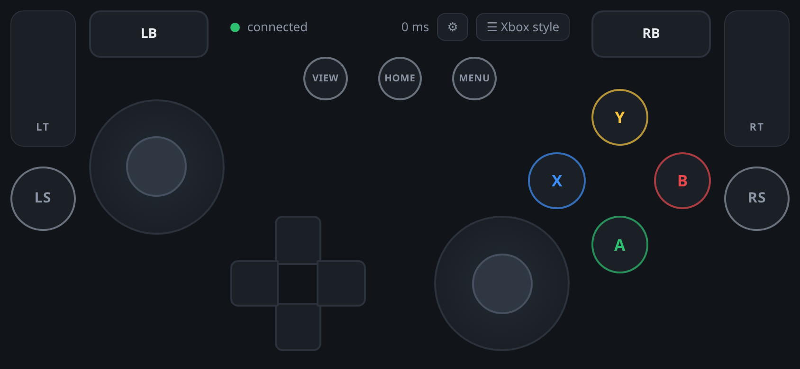<br><sub><b>Xbox style</b>: two sticks, D-pad, analog triggers</sub></td>
    <td>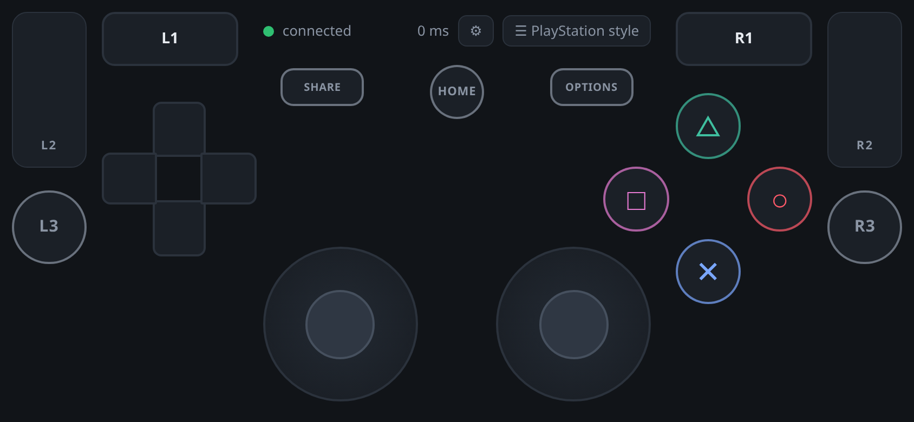<br><sub><b>PlayStation style</b>: ✕ ○ □ △, L1/R1, L2/R2</sub></td>
  </tr>
  <tr>
    <td>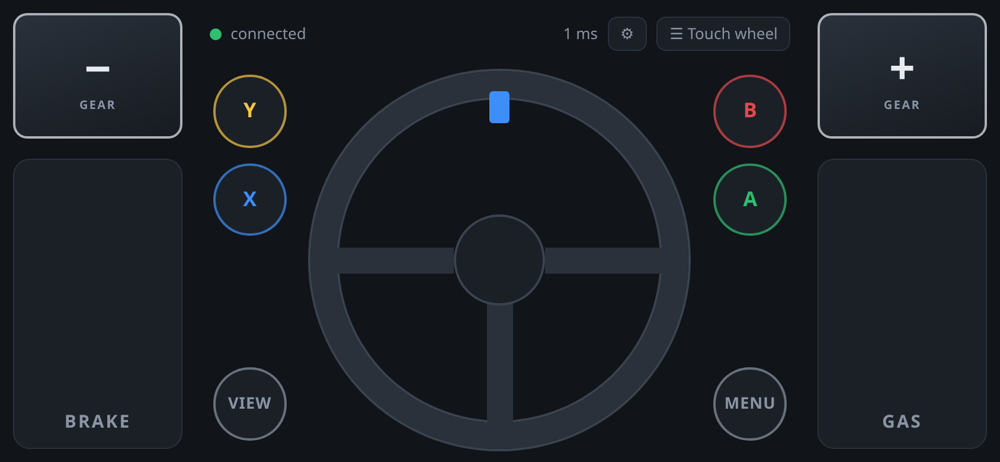<br><sub><b>Touch wheel</b>: 900° on-screen wheel that springs back</sub></td>
    <td>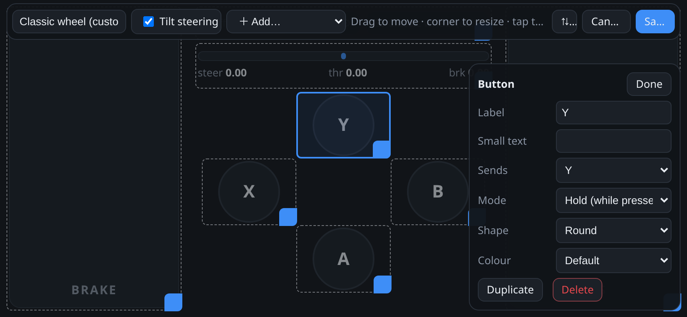<br><sub><b>Editor</b>: drag, resize, remap, add controls</sub></td>
  </tr>
  <tr>
    <td>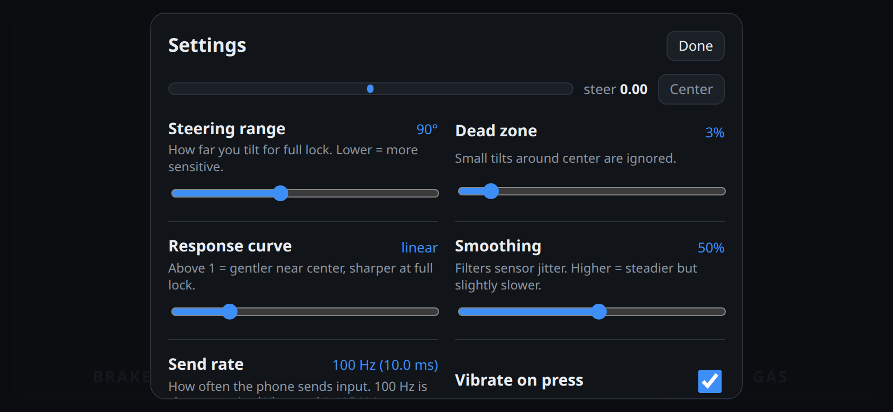<br><sub><b>Settings</b>: tune steering with a live preview</sub></td>
    <td>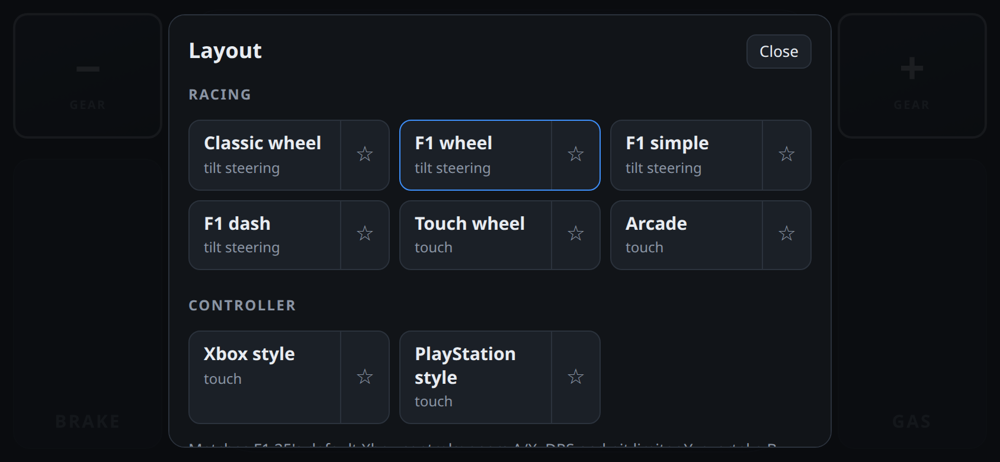<br><sub><b>Layouts</b>: switch any time, ☆ for quick switch</sub></td>
  </tr>
</table>

## 🚀 Quick start

### Windows

1. **Install the controller driver:** [ViGEmBus](https://github.com/nefarius/ViGEmBus/releases).
2. **Install [Python 3.11+](https://www.python.org/downloads/)** and get OpenStear:
   ```powershell
   git clone https://github.com/Het2239/OpenStear.git
   cd OpenStear
   python -m venv .venv
   .venv\Scripts\pip install -r requirements.txt
   ```
3. **Optional, for USB with ADB:** put Android
   [platform-tools](https://developer.android.com/tools/releases/platform-tools)
   in `vendor\platform-tools\`, or have `adb` on your PATH.
4. **Start it:**
   ```powershell
   .venv\Scripts\python -m host.main
   ```
5. **Scan the QR code** in the window with your phone, hold the phone level
   in landscape and tap **Start**. You're driving.

> [!TIP]
> Check the controller in `joy.cpl` ("Set up USB game controllers") or on
> [gamepad-tester.com](https://gamepad-tester.com).

<details>
<summary><b>Linux</b></summary>

```bash
git clone https://github.com/Het2239/OpenStear.git && cd OpenStear
python3 -m venv .venv && .venv/bin/pip install -r requirements.txt
sudo apt install python3-tk adb      # optional: desktop window and USB (ADB) mode
.venv/bin/python -m host.main
```

OpenStear creates a virtual Xbox 360 controller through `/dev/uinput`, with no
driver to install. Browsers, Steam and SDL games see a standard Xbox pad. Most
desktops already give your user access to `/dev/uinput`. If not, OpenStear
prints the one-line udev rule to add.

</details>

<details>
<summary><b>macOS</b></summary>

The phone app and server run, but macOS has no virtual-controller driver, so
inputs are only printed (`--pad log`). Handy for developing layouts.

</details>

## 🔌 Connecting your phone

| Mode | Phones | How | Notes |
|---|---|---|---|
| **USB (ADB)** | Android | Enable USB debugging, plug in, accept the prompt, scan the QR code. | Lowest latency. Nothing is opened to the network. |
| **USB tethering** | Android, iPhone | Plug in, turn on USB tethering / Personal Hotspot, scan the QR code. | Wired, without developer options. |
| **Wi-Fi** | Android, iPhone | Same Wi-Fi as the PC, scan the QR code. | Most convenient. |

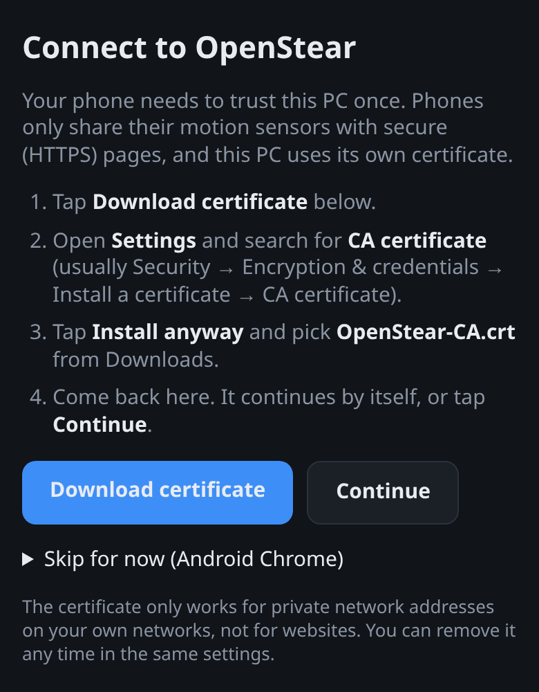

Phones only share their motion sensors with secure (HTTPS) pages, so
tethering and Wi-Fi use HTTPS with a certificate created on your PC. The first
time, the QR code opens a short setup page that walks you through trusting it,
once per PC. That certificate is limited to **private network addresses**, so
it can never be used to impersonate real websites.

Windows asks once to let Python through the firewall when you pick tethering
or Wi-Fi. Allow it on private networks.

**Install as an app:** in Android Chrome use ⋮ → *Install app*; in iPhone
Safari use Share → *Add to Home Screen*. It then opens full screen in
landscape.

<br clear="right">

## 🎮 Layouts

Pick one with **☰** on the phone. Your choice is remembered.

| Layout | Steering | What's on it |
|---|---|---|
| **Classic wheel** | Tilt | Big brake and gas pedals, A / B / X / Y |
| **F1 wheel** | Tilt | Gear paddles, pedals, DRS, radio, pit, overtake, look back, camera, flashback, MFD, mini dash |
| **F1 simple** | Tilt | Big paddles and pedals, DRS, overtake, pit, radio, MFD, menu |
| **F1 dash** | Tilt | Large live telemetry dash, paddles, pedals, DRS / OT / radio / menu |
| **Touch wheel** | On-screen wheel | 900° wheel that springs back, paddles, pedals, A / B / X / Y |
| **Arcade** | ◀ / ▶ buttons | Hold to steer, big pedals, A / B / X / Y |
| **Xbox style** | Sticks | Two sticks, D-pad, A / B / X / Y, bumpers, analog triggers, stick clicks, View / Home / Menu |
| **PlayStation style** | Sticks | The same with ✕ ○ □ △, L1 / R1, L2 / R2, L3 / R3, Share / Options |

The PC always sees an Xbox 360 controller. The F1 layouts use **F1 25's
default Xbox controls**, so they work without rebinding:

<details>
<summary>F1 button mapping</summary>

| On the phone | Xbox button | F1 25 action |
|---|---|---|
| − / + paddles | X / A | Gear down / gear up (A is also clutch) |
| DRS, PIT | Y | DRS, pit limiter |
| OT | B | Overtake |
| RADIO | LB | Radio / voice commands |
| CAM | RB | Change camera |
| LOOK | RS click | Look back |
| FLASH | View | Flashback / replay |
| MENU | Menu | Pause |
| MFD pad | D-pad | Multi-function display |

F1 24 swaps radio (RB) and overtake (LB).

</details>

## 🛠️ Make it yours

- **Editor:** ☰ → *Customise (copy)*. Drag a control to move it, drag its
  blue corner to resize, tap it to change what it sends, its label, colour or
  shape. **＋ Add** inserts buttons, pedals, sticks, a D-pad, a steering
  wheel (180–1080°), ◀ / ▶ steer buttons or an F1 dash. Overlaps are outlined
  in red.
- **Remapping:** a button can send an **Xbox button**, a full **axis** push
  (e.g. RT for a gas button) or a **keyboard key**: letters, digits, F1–F24,
  arrows, Space, Shift and more. On Windows, keys are sent as hardware scan
  codes, so DirectInput games see them too.
- **Button modes:** **Hold** (while pressed), **Toggle** (tap on, tap off,
  and the button stays lit) or **Pulse** (one short press per tap).
- **Quick switch:** ☆ two or more layouts, then **⇄** in the top bar flips
  between them mid-game, for example on foot ↔ in the car.
- **Share:** **Export** saves a `.openstear.json` file and **Import** loads
  one. Imports are checked and cleaned up first.

## 🗂️ Game profiles

On the phone, ☰ → **Save to PC as profile** stores the current layout on the
PC. In the PC window under **Game profile**:

- **Auto:** when a profile's game is running, every phone switches to it,
  and back when the game closes. Link a profile with **Manage... → Game
  program** (start the game, then pick e.g. `F1_25.exe`).
- **Always: _name_** uses that profile now. **Off** lets phones use their
  own layouts.

<p align="center">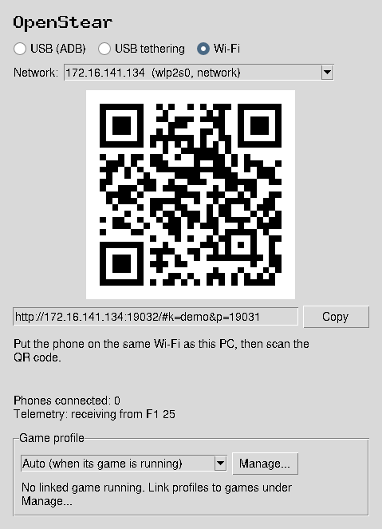</p>

## 🏁 F1 telemetry dash

With **F1 23, F1 24 or F1 25** running, the phone shows a live dash: shift
lights, gear, speed, position and lap, current and last lap time, fuel
margin, ERS charge and mode, DRS, and tyre temperatures, wear and compound.
Near the limiter the phone buzzes faster as the revs climb, like a shift
light you can feel.

1. In F1: **Settings → Telemetry Settings → UDP Telemetry: On**, IP
   `127.0.0.1`, port **20777**.
2. On the phone, pick the **F1 dash** layout. The F1 wheel layout has a mini
   version.

| Situation | Option |
|---|---|
| Game on a console or another PC | Send to this PC's IP and start with `--telemetry-lan` |
| SimHub or another app needs the data too | `--telemetry-forward 127.0.0.1:20778` passes every packet on |
| No game handy | `python -m host.telemetry.sim` sends fake F1 25 data |

## 📳 Rumble and haptics

- **Game rumble:** crashes, kerbs and gear shifts make your phone vibrate.
  The phone has a single on/off motor, so strength is made by pulsing it:
  light rumble is short buzzes, full rumble is solid. Works with Windows and
  Linux games.
- **Button feel:** a short tick on every press.
- **Shift lights:** a buzz that speeds up near the rev limiter (F1
  telemetry).

All of this is **Android only**, because iPhone browsers don't offer a
vibration API.

## ⚙️ Settings

Tap **⚙** on the phone. Changes apply instantly, with a live steering
preview. They're saved on the phone and on the PC, so a new browser picks
them up too.

| Setting | Default | What it does |
|---|---|---|
| Steering range | 90° | Tilt for full lock (lower is more sensitive) |
| Dead zone | 3% | Small tilts around center are ignored |
| Response curve | linear | Above 1 is gentler near center |
| Smoothing | 50% | Filters sensor jitter, and feels the same at any send rate |
| Send rate | 100 Hz | 60 / 100 / 125 / 250 Hz (a wired Xbox pad is ~125 Hz) |
| Vibrate on press | on | Tick on each button press |
| Game rumble | 100% | Strength of game rumble (0 = off) |
| Shift-light vibration | on | Buzz near the rev limiter |
| Show input debug | off | Tap counters; the PC logs any press that goes missing |

## 🧭 How it works

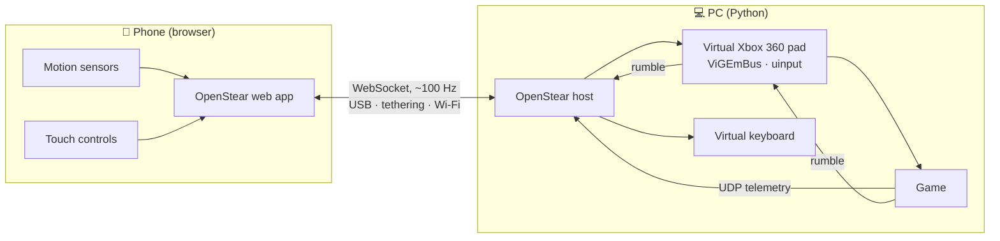

- The phone sends its **full input state** about 100 times a second, so one
  lost packet is fixed by the next.
- Steering is calibrated, shaped and smoothed **on the phone**, so the
  preview shows exactly what is sent.
- **Pairing:** the QR code carries a random token, so other devices on your
  network can't connect.
- **Fail-safe:** with no packet for 300 ms, everything goes neutral and every
  button and key is released.
- **No missed taps:** every press is held at least 40 ms, long enough for a
  game reading once per frame to see it.

## ⌨️ Command-line options

```text
python -m host.main [options]
```

| Option | Description |
|---|---|
| `--mode usb\|tether\|wifi` | Connection mode to start in (the window can switch) |
| `--port N` | Base port (default 8765; N+1 is HTTPS, N+2 the setup page) |
| `--pad auto\|vigem\|uinput\|log` | Virtual controller backend |
| `--profile auto\|off\|NAME` | Game profile selection |
| `--telemetry-port N` | UDP port for game telemetry (default 20777) |
| `--telemetry-lan` | Accept telemetry from other devices (consoles) |
| `--telemetry-forward HOST:PORT` | Pass telemetry on to another app |
| `--no-telemetry` | Don't listen for telemetry |
| `--no-adb` | Don't run `adb reverse` |
| `--no-ui` | Console only, no window |
| `--new-token` | New pairing token (unpairs all phones) |
| `-v` | Verbose logging |

Settings, the pairing token, certificates, phone settings and profiles live in
`%APPDATA%\OpenStear\` on Windows and `~/.config/OpenStear/` on Linux.

## ❓ Troubleshooting

<details>
<summary><b>The phone can't connect</b></summary>

- **USB (ADB):** check that USB debugging is on and you accepted the prompt.
  The PC window shows the phone as *ready*.
- **Wi-Fi:** phone and PC must be on the same network. Guest networks often
  block devices from seeing each other. Allow Python through the Windows
  firewall on private networks.
- Scan the QR code again. If you started with `--new-token`, old links stop
  working.
</details>

<details>
<summary><b>Steering doesn't react on Wi-Fi or tethering</b></summary>

The phone hasn't trusted the PC's certificate yet. Open the QR link again and
follow the setup page. On iPhone, also turn the certificate on under
*Settings → General → About → Certificate Trust Settings*. On iPhone, tap
**Enable motion & Start**.
</details>

<details>
<summary><b>The game doesn't see the controller</b></summary>

- **Windows:** check that ViGEmBus is installed (`joy.cpl` should list an
  Xbox 360 controller once a phone is connected).
- **Linux:** the PC window says which virtual pad backend is in use. If it
  says *log-only*, follow the printed udev rule.
- Some old games only read DirectInput. Most modern games read XInput.
</details>

<details>
<summary><b>Keyboard keys don't work in one game</b></summary>

Windows blocks programs from sending keys into games running as
administrator. Run OpenStear as administrator too.
</details>

<details>
<summary><b>No vibration</b></summary>

Vibration works on Android only, because iPhone browsers have no vibration
API. Check ⚙ → *Game rumble* and *Vibrate on press*, and that the phone isn't
in silent or battery-saver mode.
</details>

<details>
<summary><b>The F1 dash says "No telemetry yet"</b></summary>

Turn on UDP telemetry in F1 (port 20777, IP 127.0.0.1). If another app such
as SimHub already uses port 20777, the PC window says so. Close it, or
chain it with `--telemetry-forward`.
</details>

## 🧑‍💻 Development

```text
host/            Python PC host
  main.py        entry point and CLI
  core.py        connection modes, listeners, profiles, telemetry loop
  server.py      web server + WebSocket protocol, fail-safe, button latch
  gamepad.py     ViGEmBus backend        uinput_pad.py  Linux backend + rumble
  keyboard_out.py  SendInput / uinput keyboard
  certs.py       local CA + HTTPS certs  network.py     interfaces, tethering
  profiles.py    game profiles           ui.py          desktop window
  telemetry/     F1 UDP decoder, listener and simulator
web/             phone app: plain HTML/CSS/JS, no build step
  controls.js    on-screen controls      editor.js      layout editor
  layouts/       built-in layouts (JSON) sensors.js     tilt steering
tests/           pytest + node tests
```

```bash
pip install -r requirements-dev.txt
pytest                                        # unit + integration tests
OPENSTEAR_UINPUT_TEST=1 pytest tests/test_uinput_real.py   # real Linux pad
python -m host.telemetry.sim                  # fake F1 telemetry
```

Open `http://localhost:8765/#preview&layout=f1` to preview a layout in a
desktop browser. CI runs the tests on Linux and Windows with Python 3.11 and
3.13.

On Windows, set `OPENSTEAR_VIGEM_TEST=1` to check the real ViGEmBus pad and
rumble, or `OPENSTEAR_KEYBOARD_TEST=1` to check key output (it only presses
F13).

## 🗺️ Roadmap

- [x] Tilt steering over USB, tethering and Wi-Fi
- [x] Settings, installable app, layouts and editor
- [x] Remapping, button modes, game profiles
- [x] Rumble and F1 telemetry dash
- [ ] One-click Windows installer (bundles ViGEmBus) and release builds
- [ ] Telemetry for more games (Forza, Assetto Corsa, BeamNG)

See [plan.md](plan.md) for the full plan.

## 🤝 Contributing

Issues and pull requests are welcome. New layouts are just JSON files in
`web/layouts/`, so they're a great first contribution. Please run `pytest`
before opening a PR.

## 📄 License

[MIT](LICENSE) © OpenStear contributors.

Built on [ViGEmBus](https://github.com/nefarius/ViGEmBus) (BSD-3),
[vgamepad](https://github.com/yannbouteiller/vgamepad) (MIT),
[aiohttp](https://github.com/aio-libs/aiohttp), [qrcode](https://github.com/lincolnloop/python-qrcode),
[cryptography](https://github.com/pyca/cryptography) and [psutil](https://github.com/giampaolo/psutil).

<sub>OpenStear is not affiliated with Microsoft, Sony, Electronic Arts or
Codemasters. Xbox, PlayStation and F1 are trademarks of their respective
owners and are used only to describe compatibility.</sub>
